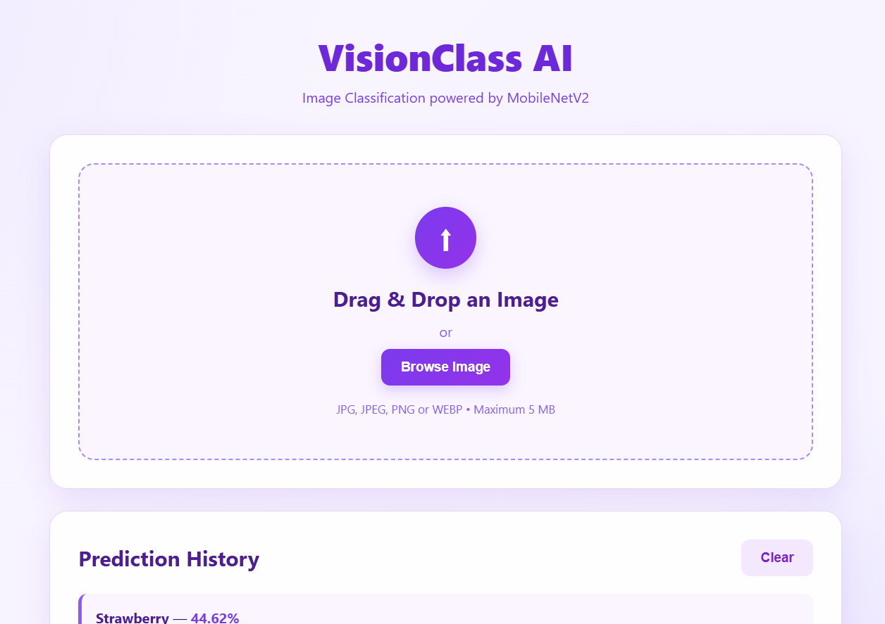
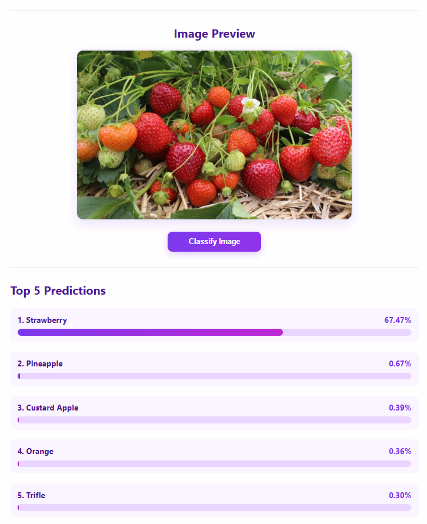
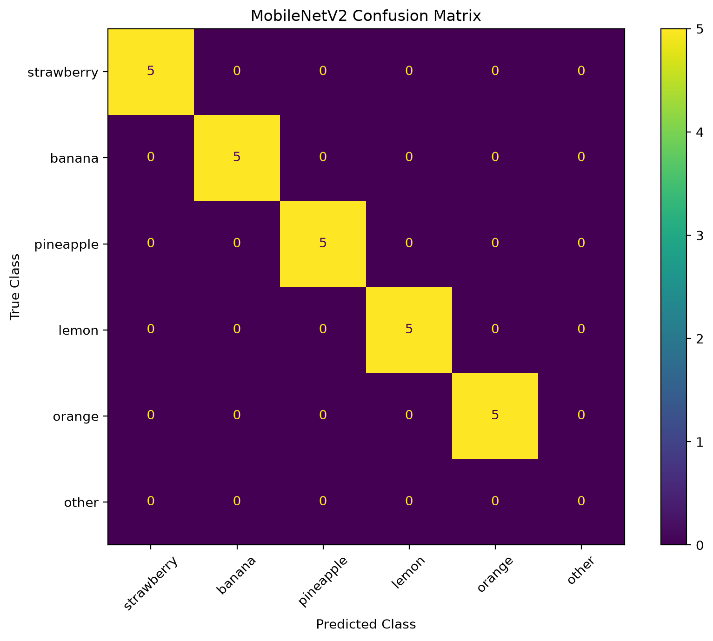

# VisionClass AI

## Image Classification Web Application

VisionClass AI is an image classification web application built using a pretrained MobileNetV2 convolutional neural network.

The application allows users to upload an image through a web interface and receive the Top-5 predicted classes along with their confidence scores.

The project includes a FastAPI backend, interactive frontend, pretrained deep learning model, model evaluation, and confusion matrix analysis.

---

## Features

- Image classification using pretrained MobileNetV2
- Top-5 predictions with confidence scores
- Drag-and-drop image upload
- Image preview before classification
- Confidence bar visualization
- Prediction history
- FastAPI REST API
- Swagger API documentation
- JPG, JPEG, PNG, and WEBP support
- Maximum upload size of 5 MB
- Invalid file and error handling
- Custom model evaluation
- Top-1 and Top-5 accuracy
- Confusion matrix
- CPU and GPU support

---

## Demo

### Web Interface

The application provides a simple interactive interface where users can upload an image and view the model predictions.



### Prediction Result

The application displays the Top-5 predicted classes and their confidence scores.



### Confusion Matrix

The pretrained MobileNetV2 model was evaluated on a custom dataset containing 25 images across five ImageNet-1K classes.



---

## Model

### MobileNetV2

The application uses the pretrained **MobileNetV2** model provided by Torchvision.

**Model details:**

- Architecture: MobileNetV2
- Framework: PyTorch
- Dataset: ImageNet-1K
- Number of classes: 1000
- Input size: 224 × 224 RGB
- Parameters: 3,504,872
- Device: CPU/GPU depending on availability

The pretrained weights are used directly without additional fine-tuning.

---

## Official Model Metrics

The official benchmark metrics associated with the pretrained MobileNetV2 ImageNet-1K weights are:

| Metric | Accuracy |
|---|---:|
| Top-1 Accuracy | 72.154% |
| Top-5 Accuracy | 90.822% |

These are official pretrained model benchmark values and are separate from the custom evaluation performed for this project.

---

## Custom Evaluation

A custom evaluation dataset containing 25 images was created using five ImageNet-1K classes.

| Class | Images |
|---|---:|
| Strawberry | 5 |
| Banana | 5 |
| Pineapple | 5 |
| Lemon | 5 |
| Orange | 5 |
| **Total** | **25** |

### Results

| Metric | Result |
|---|---:|
| Top-1 Accuracy | **100.00%** |
| Top-5 Accuracy | **100.00%** |

All 25 images were correctly classified in the Top-1 prediction.

> **Note:** The 100% accuracy applies only to this small custom 25-image evaluation set. It should not be interpreted as the model's general ImageNet-1K accuracy.

---

## Confusion Matrix

The confusion matrix was generated using the custom 25-image evaluation dataset.

The diagonal values show that all evaluated images were correctly classified in the Top-1 prediction.


---

## Technology Stack

### Backend

- Python
- FastAPI
- Uvicorn
- PyTorch
- Torchvision
- Pillow

### Frontend

- HTML
- CSS
- JavaScript

### Machine Learning

- MobileNetV2
- ImageNet-1K
- Transfer learning / pretrained CNN inference

### Evaluation

- Scikit-learn
- Matplotlib

---

## API

### Health Check

```http
GET /api/healths